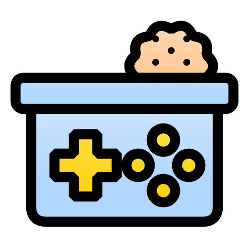
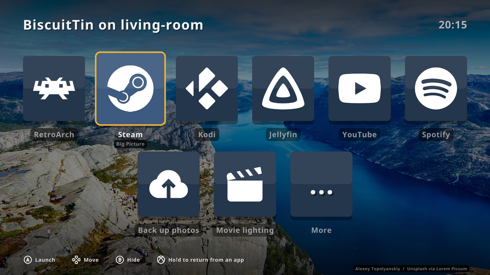
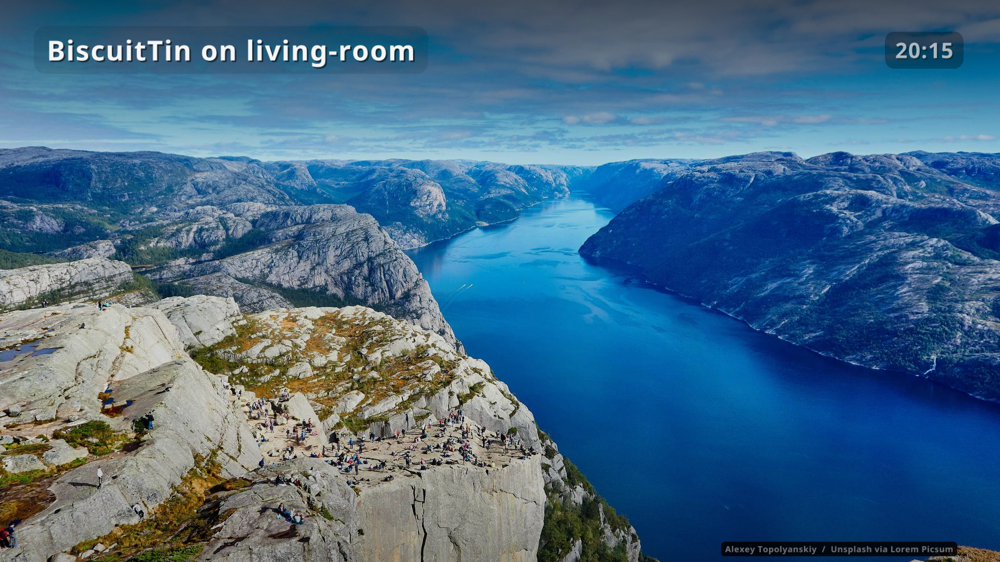
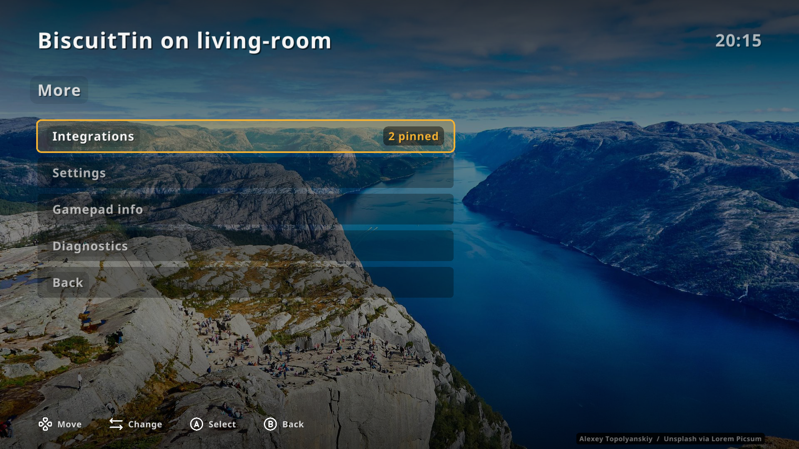
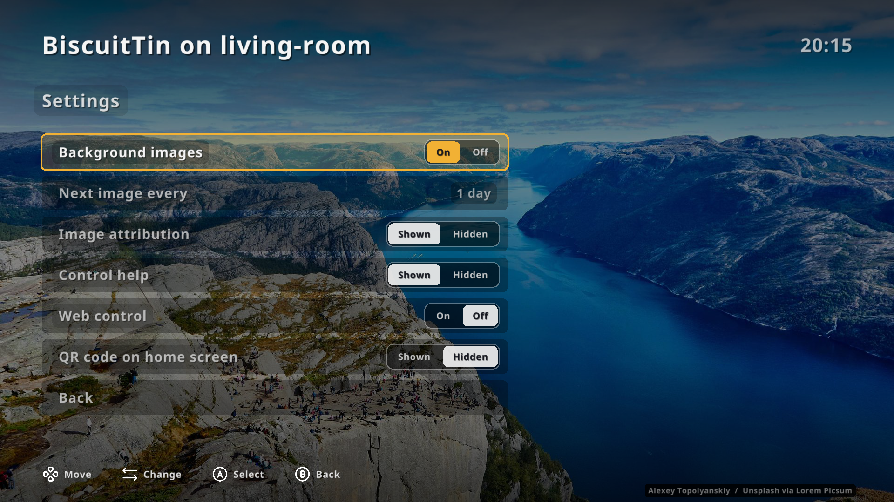

<div align = "center">
  
  <h1>biscuittin</h1>

  A full-screen app launcher for TV boxes, driven by a gamepad, a remote control
  (which presents as a keyboard) or arrow keys. Rendered with OpenGL via
  [raylib-go](https://github.com/gen2brain/raylib-go); configured with YAML.

[](#none)
[](https://discord.gg/jhYWWpNJ3v)
[](https://github.com/jamesread/biscuittin/actions/workflows/build.yml)

[](https://goreportcard.com/report/github.com/jamesread/biscuittin)

</div>

**Documentation: <https://jamesread.github.io/biscuittin>**

## Screenshots

### Home screen



Every app, game and home automation you use on the TV as a big, readable tile, picked with a gamepad, a remote or the arrow keys, over a rotating royalty-free photo.

### Ambient background



When nobody is using it, the tiles fade away to show the photo and its credit, with the clock still visible. Any button brings them back.

### More menu



Integrations, settings, gamepad info and diagnostics are one button away, and every menu works from the sofa with just a d-pad and two buttons.

### Settings



Change the background photos, image credits, control help and the phone web remote on screen; choices are saved without touching your config file.

Screenshots use fictional test data and are regenerated with `make screenshots`
(see [`var/marketing/screenshots`](var/marketing/screenshots/README.md)).

## Install

biscuittin is distributed as a Flatpak. Download
`biscuittin_<version>_x86_64.flatpak` from the
[latest release](https://github.com/jamesread/biscuittin/releases), then:

```sh
flatpak install --user biscuittin_<version>_x86_64.flatpak
flatpak run io.github.jamesread.biscuittin
```

Its config lives in `~/.var/app/io.github.jamesread.biscuittin/config/biscuittin/`.
Tiles run their commands on the host (via `flatpak-spawn --host`), so the
sandbox doesn't limit what entries can do. See the
[installation docs](https://jamesread.github.io/biscuittin/install.html).

## Controls

| Input | Action |
|---|---|
| D-pad / left stick / arrow keys / WASD | Move (hold to repeat) |
| A / Start / Enter / Space | Launch |
| B / Backspace | Back; on the home screen, hide the tiles |
| Esc | Back in menus; on the home screen, ask to exit |
| Hold Guide (Xbox button) | Bring the launcher back while an app is running |
| Ctrl+Q or More > System > Exit | Quit without asking |

## Launching

Apps are started in their own session (`setsid`) with stdin from `/dev/null`
and output appended to `~/.cache/biscuittin/<title>.log`, so they keep running
if biscuittin exits or is killed. With `hideOnLaunch`, the launcher unmaps
itself while the app runs and returns when it exits (unless the entry sets
`restoreOnExit: false`) or when Guide is held.

## Icons

Entries without an `icon` file get one from the `iconProviders` list (default
`[thesvg]`, i.e. [thesvg.org](https://thesvg.org)), searched by the entry title
or `iconQuery`. Only exact slug/title/alias matches are used. SVGs are rendered
to PNG and cached under `~/.cache/biscuittin/icons/`; nothing is bundled with
the app. Lookups run in the background, so tiles show a letter until their icon
arrives. Unmatched lookups are retried after a day; the thesvg manifest is
refreshed weekly.

## Background images

Royalty-free images rotate behind the launcher, alternating between providers:
`wikimedia` (featured Commons landscapes, cityscapes and similar scenery,
matching the window orientation; Picture of the Day is not used) and
`picsum` (Lorem Picsum, Unsplash licence, requested at the current window
size; Picsum has no subject tags, so it cannot be filtered the same way). The
`local` provider shows your own images from `backgrounds.dir` instead, in file
name order, with no downloads. The author and licence are shown bottom-right
(for `local`, from a `<image>.credit` file next to each image). Images are cached under
`~/.cache/biscuittin/backgrounds/` (newest 150 per provider), and cached images
are reused when offline. The last 5 shown are kept in `backgrounds/recent/` and
the newest is displayed immediately at startup, before providers are queried.

After `idleFadeSeconds` (default 20) without input, the tiles, menus and hints
fade out and the overlay lightens so the image can be seen; the title, clock
and credit stay. Configured RSS and Atom feeds slide in as article cards at the bottom left
(feed name, title and a short excerpt). Each headline stays at least a minute
and is not repeated in the same session. Any key, button or stick movement
brings the tiles back within a fifth of a second, and that waking input is
not acted on.

In **More**, "Background images" toggles them and "Next image every" /
"Next headline every" set the intervals (1 minute to 1 day). Use left/right
to change a value, or A to cycle it. Choices are saved to
`~/.local/state/biscuittin/settings.yaml`.

## Integrations: OliveTin and Home Assistant

Each configured integration adds a list under **More > Integrations**. Press A on an item to
pin or unpin it; pinned items become tiles after your configured entries, and
are saved to `settings.yaml` (with their titles, so tiles appear even when the
server is down).

- **OliveTin** (`olivetin.url`): every action you can run, grouped by dashboard
  or host. Tiles call `StartAction` and report finished/failed (exit code).
- **Home Assistant** (`homeassistant.url`): every automation. Tiles call
  `automation.trigger`. Put a long-lived access token in
  `~/.config/biscuittin/homeassistant.token` (or set `tokenFile`/`token`).

## OliveTin

Set `olivetin.url` and **More > Integrations > OliveTin actions** lists every action the
OliveTin server lets you run, grouped by dashboard or host. Press A to pin or
unpin one; pinned actions become tiles after your configured entries. Starting
one calls `StartAction` with the arguments' defaults, then shows whether it
finished or failed (exit code). Actions with arguments that have no default are
shown but can't be pinned. Their `iconify-icon` icons are fetched from the
Iconify API and cached like other icons.

## Settings and idle

**More > Settings** has: background images (On/Off), the image interval, image
attribution (Shown/Hidden) and control help (Shown/Hidden). Two-way choices use
a radio group, modelled on picocrank's RadioGroup: left/right pick an option,
A cycles. Pressing B / Backspace on the home screen hides the tiles straight
away, as if idle (RSS headlines show if feeds are configured); any input
brings them back. Esc on the home screen asks whether to exit.

## Control help

The footer shows controls for the primary input device: whichever was used
last, or the gamepad if one is connected at startup. Gamepad hints use button
glyphs matched to the controller (Xbox-style, or PlayStation when the name says
so); keyboard and remote hints show keycaps. Settings > Control help hides them.
More > Diagnostics shows the current primary input.

## Web control

Web control is **off by default**: nothing listens on the network until you
switch it on. **More > Settings > Web control** then starts a small web server
on `0.0.0.0` (port `$PORT`, `webControl.port`, or 8137) serving a
touch-friendly remote: a d-pad, OK and Back, plus a button per tile. **QR code
on home screen** (also off by default) shows its address so a phone can scan
it, only while web control is running. Diagnostics shows the URL.

The page talks to biscuittin over ConnectRPC (`protocol/biscuittin/v1/remote.proto`,
`RemoteService`), so other clients can use the same API. There is no
authentication; only enable it on a trusted network.

## Config

`~/.config/biscuittin/config.yaml`, or `-config <path>`. A default is written
on first start if the file is missing. See
[config.example.yaml](config.example.yaml). Use `-windowed` to test on a desktop,
or `-size 1920x1080` for a window of exactly that size.

`-script <file>` drives the UI from a file of steps (presses, a fixed clock,
saving the window as a PNG) and quits at the end; it is how the marketing
screenshots are taken. The step format is described in [desktop/internal/app/script.go](desktop/internal/app/script.go).

## Build

```sh
make build                 # builds desktop/biscuittin; needs Go, gcc, X11/GL headers, npm
make test lint
make flatpak               # a Flatpak bundle in dist/, built in the Freedesktop SDK
make docs                  # the docs site (Antora), in build/site
```

The Go app is in `desktop/` (`cmd/biscuittin` plus packages under
`internal/`); see the [code layout](https://jamesread.github.io/biscuittin/dev/layout.html).

## Contributing and releases

Commits follow [Conventional Commits](https://www.conventionalcommits.org)
(`feat:`, `fix:`, ...), which semantic-release uses to version and release
from `main`; GoReleaser then builds and attaches the Flatpak. Install the
hooks with `pre-commit install --hook-type pre-commit --hook-type commit-msg`.
See [commits and releases](https://jamesread.github.io/biscuittin/dev/releasing.html).

## Third-party assets

Gamepad button glyphs in `desktop/internal/app/assets/gamepad/` are from
[Tabler Icons](https://tabler.io/icons) by Paweł Kuna, MIT licensed; see
`desktop/internal/app/assets/gamepad/LICENSE`. They are embedded in the binary.
The Flatpak bundles the [Noto Sans](https://notofonts.github.io) Bold font,
under the SIL Open Font License 1.1.

## License

biscuittin is licensed under the [GNU Affero General Public License v3.0](LICENSE).
